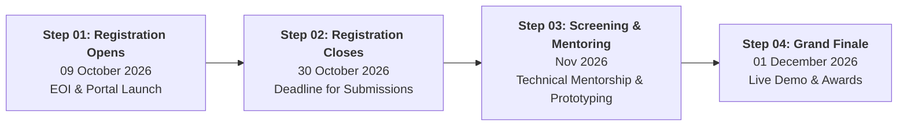

# Intelligent Battery Cell 4.0 Hackathon 2026 (IBC 4.0)

<div align="center">

[](https://react.dev/)
[](https://vitejs.dev/)
[](https://threejs.org/)
[](https://greensock.com/gsap/)
[](https://vercel.com/)
[](LICENSE)
[](https://github.com/Dubey404aasutosh/Saset_Hackathon_website_/pulls)

**National Battery R&D | India Hackathon 2026**

*Advancing Battery Safety, Electrochemical Sustainability & Sovereign Indigenous Innovation through Artificial Intelligence.*

[Explore Themes](#-hackathon-themes) • [Interactive Features](#-interactive-web-features) • [Prizes & Fees](#-prizes--participant-benefits) • [Timeline](#-important-dates--timeline) • [Quick Start](#-quick-start--local-development)

</div>

---

## 📖 Table of Contents

- [About The Project](#-about-the-project)
- [Interactive Web Features](#-interactive-web-features)
- [Hackathon Themes](#-hackathon-themes)
- [Eligibility & Categories](#-eligibility--participant-categories)
- [Timeline & Milestones](#-important-dates--timeline)
- [Registration Fees](#-registration-fees)
- [Prizes & Benefits](#-prizes--participant-benefits)
- [Hackathon Evaluation Stages](#-hackathon-stages)
- [Tech Stack](#-tech-stack)
- [Project Structure](#-project-structure)
- [Quick Start & Local Development](#-quick-start--local-development)
- [Deployment](#-deployment)
- [Contributing](#-contributing)
- [License & Permissions](#-license--permissions)

---

## ⚡ About The Project

The **Intelligent Battery Cell 4.0 Hackathon 2026 (IBC 4.0)** brings together students, research scholars, academic institutions, early-stage start-ups, and MSME innovators to build next-generation solutions for energy storage.

This repository hosts the official, immersive web application for the hackathon. Designed with an aeronautical avionics aesthetic, the portal pairs interactive 3D WebGL visualizations, real-time battery simulation sandboxes, and smooth telemetry interfaces with comprehensive hackathon registration and informational workflows.

### 🎯 Mission & Objectives
- **Lab to Giga-scale:** Bridge the gap between academic battery prototypes and gigawatt-scale production deployment.
- **AI-Powered Diagnostics:** Leverage machine learning for real-time physics simulations, electrochemical digital twins, and early micro-dendrite detection.
- **Thermal Safety:** Eliminate thermal runaway events using proactive sensing and intelligent BMS algorithms.
- **Sovereign Supply Chains:** Foster indigenous Indian battery chemistries (e.g., sodium-ion, solid-state, novel cathode formulations) independent of foreign raw material monopolies.

---

## 🌟 Interactive Web Features

The portal offers an avionics-inspired digital experience designed to engage researchers, developers, and industry sponsors:

- 🌌 **3D WebGL Flight Canvas & Halftone Shaders:** Custom Three.js render pipeline featuring procedural volumetric cloudscapes and retro-futuristic halftone post-processing.
- 🎛️ **Sticky Avionics & Battery Telemetry HUD:** Fixed real-time telemetry readout displaying simulated altitude, voltage states, cell temperature, and health indicators.
- 🧪 **Interactive Degradation & Dendrite Simulator:** Live interactive sandbox enabling users to adjust operational parameters (C-rate, ambient temperature, cycles) to model risk probabilities.
- ⚖️ **PromptSplit Architecture Comparator:** Side-by-side interactive comparison matrix evaluating cell topologies, chemistries, and deployment trade-offs.
- 🧬 **Loewy MAYA Spectrum:** Interactive progressive innovation visualizer inspired by Raymond Loewy's "Most Advanced Yet Acceptable" design principle.
- 📜 **Continuous Cloudscape & Word Reveal:** High-performance GSAP scroll-triggered text reveals and fluid transitions.
- 📝 **Expression of Interest (EOI) Portal:** Integrated client-side validated registration form for instant participant team applications.

---

## 🔬 Hackathon Themes

Participants can develop hardware, software, or hybrid innovations under any of the following 8 core domains:

| # | Theme | Focus Area & Description |
|:---:|:---|:---|
| **01** | **Intelligent Battery Management Systems (BMS)** | Edge-AI and embedded algorithms for adaptive state-of-charge (SoC), state-of-health (SoH), and predictive cell balancing. |
| **02** | **Battery Safety & Thermal Runaway Mitigation** | Early detection of internal micro-shorts, dendrite growth, degassing precursors, and automated active fire suppression systems. |
| **03** | **Smart Fast Charging & Second-Life Storage** | Non-damaging rapid pulse charging algorithms and automated grading/cascading of retired EV batteries into grid-scale second-life applications. |
| **04** | **Renewable Energy Storage & Grid Stability** | Large-scale BESS orchestration with AI frequency response, peak shaving, and distributed microgrid load management. |
| **05** | **Battery Diagnostics & Digital Twins** | Real-time electrochemical impedance spectroscopy (EIS) modeling, multi-physics finite element analysis, and cloud digital twins. |
| **06** | **IoT-Enabled Fleet & Cell Monitoring** | Low-power telemetry nodes, CAN-bus integration, edge telemetry, and predictive maintenance dashboards for EV fleets. |
| **07** | **Indigenous Battery Technologies** | Development of domestic non-lithium architectures (sodium-ion, zinc-air, flow batteries) utilizing localized Indian mineral supply chains. |
| **08** | **Specialized & Defense Applications** | Ruggedized energy storage solutions for extreme high/low temperatures, high-altitude military applications, aerospace, and naval operations. |

---

## 👥 Eligibility & Participant Categories

The hackathon provides tailored tracks across three distinct participant tiers:

1. **Category 01 — Students & Research Scholars**
   - Currently enrolled undergraduate, postgraduate, or PhD scholars from recognized universities and institutes.
2. **Category 02 — Student Start-ups**
   - Early-stage ventures founded or co-founded by active students within academic incubators.
3. **Category 03 — MSMEs & Registered Start-ups**
   - Formally registered MSME entities, commercial deep-tech startups, and industry R&D organizations.

---

## 📅 Important Dates & Timeline



| Phase | Milestone | Date / Timeline | Details |
|---|---|---|---|
| **Stage 01** | **Registration & EOI Opens** | **09 October 2026** | Expression of Interest (EOI) launched. Registration portal active. |
| **Stage 02** | **Application Deadline** | **30 October 2026** | Final date to submit team profiles, abstracts, and thematic selections. |
| **Stage 03** | **Screening & Technical Mentoring** | **November 2026** | Expert jury evaluation of submissions. Shortlisted teams pair with R&D mentors to refine functional prototypes. |
| **Stage 04** | **Grand Finale** | **01 December 2026** *(Tentative)* | In-person demonstration, technical jury review, awards ceremony, and incubation onboarding. |

---

## 💳 Registration Fees

Category-wise registration fee structure:

| Category | Fee (INR) | Inclusions |
|:---|:---:|:---|
| **Students & Research Scholars** | **₹500/-** | Hackathon access, screening review, digital participation certificates, mentorship eligibility |
| **Student Start-ups** | **₹1,500/-** | Pitch evaluation, industry mentor allocation, incubation qualification pipeline |
| **MSMEs & Registered Start-ups** | **₹2,000/-** | Direct jury showcase, pilot consideration, investor & defense ecosystem networking |

---

## 🏆 Prizes & Participant Benefits

- 💰 **Cash Prizes:** **Up to ₹2,00,000 (₹2 Lakhs)** in pooled cash prizes for top innovative teams across categories.
- 📜 **Official Certification:** National-level merit certificates for winners and official participation credentials for all qualified submissions.
- 🧑‍🏫 **Dedicated Technical Mentorship:** One-on-one working sessions with battery scientists, power electronics engineers, and AI specialists.
- 🚀 **Incubation & Pilot Pathways:** Direct fast-track incubation entry, laboratory access, and venture acceleration for commercially viable prototypes.

---

## 🚀 Hackathon Stages

```mermaid
sequenceDiagram
    autonumber
    actor Participant as Teams / Start-ups
    participant Portal as IBC 4.0 Web Portal
    participant Jury as Expert Screening Panel
    participant Mentors as Industry & R&D Mentors
    participant Finale as Grand Finale Jury

    Participant->>Portal: Submit EOI & Register Theme
    Portal-->>Participant: Confirmation & Application Dossier
    Participant->>Jury: Technical Abstract & Solution Proposal
    Jury->>Participant: Shortlist Notification
    Mentors->>Participant: Intensive Mentorship & Prototype Refinement
    Participant->>Finale: Live Demonstration & Pitch
    Finale-->>Participant: Cash Prizes, Certificates & Incubation
```

---

## 🛠️ Tech Stack

This portal is engineered with modern frontend standards, prioritizing 60fps rendering, responsive typography, and lightweight asset loading:

| Layer | Technology | Purpose |
|---|---|---|
| **Core Framework** | [React 19](https://react.dev/) | Component architecture, state management, and lifecycle hooks |
| **Build & Bundling** | [Vite 6](https://vitejs.dev/) | Lightning-fast HMR and optimized Rollup production builds |
| **3D & Shaders** | [Three.js](https://threejs.org/) | WebGL flight canvas, procedural halftone shader, and volumetric rendering |
| **Motion & Animation** | [GSAP 3](https://greensock.com/gsap/) | ScrollTrigger animations, smooth text reveals, and atmospheric transitions |
| **Icons** | [Lucide React](https://lucide.dev/) | Sleek, consistent stroke icons for avionics & UI components |
| **Styling** | Vanilla CSS Tokens | Design system with custom themes, high-contrast HUD layouts, and glassmorphism |
| **Hosting & CI/CD** | [Vercel](https://vercel.com/) | Edge routing, asset optimization, and single-command deployment |

---

## 📂 Project Structure

```text
├── public/
│   ├── ascii-editor/          # ASCII schematic tools and assets
│   └── brand/                 # Vector brand logos, glyphs, and artwork
│       ├── art/               # Background graphics, avionics illustrations
│       └── resonance/         # Dark/light brand glyphs and favicons
├── scripts/
│   ├── download_reference_assets.js
│   ├── generate_battery_schematics.js
│   └── generate_tech_icons.js
├── src/
│   ├── components/            # Modular React components
│   │   ├── AltitudeHud.jsx           # Real-time avionics telemetry HUD
│   │   ├── BatteryEvolutionChart.jsx # Interactive battery tech progression chart
│   │   ├── CloudscapeTransition.jsx  # Atmospheric mist scroll transition
│   │   ├── EvaluationSection.jsx     # Hackathon evaluation criteria & breakdown
│   │   ├── FAQSection.jsx            # Accordion FAQ interface
│   │   ├── FlightCanvas.jsx          # Three.js 3D WebGL flight shader canvas
│   │   ├── GroundForm.jsx            # EOI registration form with validation
│   │   ├── Masthead.jsx              # Hero masthead with dynamic brand mark cycler
│   │   ├── MayaSpectrum.jsx          # Loewy MAYA spectrum innovation matrix
│   │   ├── PrizesAndFees.jsx         # Prize pool & registration fee calculator
│   │   ├── ProbabilitySimulator.jsx  # Real-time cell degradation simulator
│   │   ├── PromptSplit.jsx           # Side-by-side architecture comparator
│   │   ├── ScrollRevealText.jsx      # Progressive word-by-word scroll reveal
│   │   ├── SitePreloader.jsx         # Session preloader transition
│   │   ├── Statement.jsx             # Key highlight banner and badges
│   │   ├── ThemesGrid.jsx            # 8-theme interactive exploration grid
│   │   ├── TimelineSection.jsx       # Milestone roadmap & dates display
│   │   └── ui/                       # Reusable UI primitives
│   ├── App.jsx                # Application orchestration root
│   ├── index.css              # Global tokens, typography & aesthetic rules
│   └── main.jsx               # React DOM hydration entrypoint
├── index.html                 # HTML5 template with SEO meta tags & favicon
├── package.json               # Dependencies & scripts
├── vercel.json                # Vercel SPA rewrite & deployment rules
├── vite.config.js             # Vite configuration
└── README.md                  # Project documentation
```

---

## 🚀 Quick Start & Local Development

Follow these steps to run the portal on your local machine:

### Prerequisites
- [Node.js](https://nodejs.org/) (version **18.x** or higher recommended)
- `npm` (bundled with Node.js) or `pnpm` / `yarn`

### 1. Clone the Repository
```bash
git clone https://github.com/Dubey404aasutosh/Saset_Hackathon_website_.git
cd Saset_Hackathon_website_
```

### 2. Install Dependencies
```bash
npm install
```

### 3. Launch Development Server
```bash
npm run dev
```
Open your browser and navigate to `http://localhost:5173` (or the port specified in terminal).

### 4. Build for Production
To generate an optimized production bundle:
```bash
npm run build
```
Built assets will be emitted into the `dist/` directory.

### 5. Preview Production Build
```bash
npm run preview
```

---

## 🌐 Deployment

The application is pre-configured for instant deployment on [Vercel](https://vercel.com/) with single-page application (SPA) routing support via `vercel.json`:

```json
{
  "framework": "vite",
  "buildCommand": "npm run build",
  "outputDirectory": "dist",
  "rewrites": [
    {
      "source": "/(.*)",
      "destination": "/index.html"
    }
  ]
}
```

### Deploying to Vercel
1. Install Vercel CLI: `npm i -g vercel`
2. Link & deploy: `vercel`
3. Deploy to production: `vercel --prod`

Alternatively, connect your GitHub repository directly within the Vercel Dashboard for automated CI/CD branch deployments.

---

## 🤝 Contributing

Contributions, feedback, and issue reports are welcomed!

1. **Fork** the repository
2. **Create your feature branch:**
   ```bash
   git checkout -b feature/amazing-feature
   ```
3. **Commit your changes:**
   ```bash
   git commit -m "feat: add amazing feature"
   ```
4. **Push to the branch:**
   ```bash
   git push origin feature/amazing-feature
   ```
5. **Open a Pull Request** with a detailed summary of your additions.

---

## 📄 License & Permissions

**Copyright © 2026 [Aasutosh Dubey](https://github.com/Dubey404aasutosh). All Rights Reserved.**

This project, its code, architecture, designs, 3D assets, and documentation are strictly **proprietary**.

> [!CAUTION]
> **Strictly No Unauthorized Use:** No individual or organization is permitted to copy, reproduce, modify, distribute, sublicense, sell, reverse engineer, or deploy this software or any part of it without explicit prior written permission from the copyright holder.

For permissions, licensing inquiries, or collaborations, contact:
- **Author:** Aasutosh Dubey
- **GitHub:** [@Dubey404aasutosh](https://github.com/Dubey404aasutosh)
- **Email:** [dubeyaasutosh62@gmail.com](mailto:dubeyaasutosh62@gmail.com)

See the full [LICENSE](LICENSE) file for complete legal terms.

---

<div align="center">
  <sub>Intelligent Battery Cell 4.0 Hackathon 2026 (IBC 4.0) • National Battery R&D Initiative</sub>
</div>
