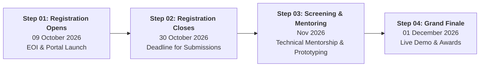

# Intelligent Battery Cell 4.0 Hackathon 2026 (IBC 4.0)

**National Battery R&D | India Hackathon 2026**

*Advancing Battery Safety, Electrochemical Sustainability & Sovereign Indigenous Innovation through Artificial Intelligence.*

[Explore Themes](#-hackathon-themes) • [Interactive Features](#-interactive-web-features) • [Prizes & Fees](#-prizes--participant-benefits) • [Timeline](#-important-dates--timeline) • [Quick Start](#-quick-start--local-development)

## ⚡ About The Project

The **Intelligent Battery Cell 4.0 Hackathon 2026 (IBC 4.0)** brings together students, research scholars, academic institutions, early-stage start-ups, and MSME innovators to build next-generation solutions for energy storage.

This repository hosts the official, immersive web application for the hackathon. Designed with an aeronautical avionics aesthetic, the portal pairs interactive 3D WebGL visualizations, real-time battery simulation sandboxes, and smooth telemetry interfaces with comprehensive hackathon registration and informational workflows.

### 🎯 Mission & Objectives
- **Lab to Giga-scale:** Bridge the gap between academic battery prototypes and gigawatt-scale production deployment.
- **AI-Powered Diagnostics:** Leverage machine learning for real-time physics simulations, electrochemical digital twins, and early micro-dendrite detection.
- **Thermal Safety:** Eliminate thermal runaway events using proactive sensing and intelligent BMS algorithms.
- **Sovereign Supply Chains:** Foster indigenous Indian battery chemistries (e.g., sodium-ion, solid-state, novel cathode formulations) independent of foreign raw material monopolies.

---

## 🔬 Hackathon Themes

Participants can develop hardware, software, or hybrid innovations under any of the following 8 core domains:

| # | Theme | Focus Area & Description |
|:---:|:---|:---|
| **01** | **Intelligent Battery Management Systems (BMS)** | Edge-AI and embedded algorithms for adaptive state-of-charge (SoC), state-of-health (SoH), and predictive cell balancing. |
| **02** | **Battery Safety & Thermal Runaway Mitigation** | Early detection of internal micro-shorts, dendrite growth, degassing precursors, and automated active fire suppression systems. |
| **03** | **Smart Fast Charging & Second-Life Storage** | Non-damaging rapid pulse charging algorithms and automated grading/cascading of retired EV batteries into grid-scale second-life applications. |
| **04** | **Renewable Energy Storage & Grid Stability** | Large-scale BESS orchestration with AI frequency response, peak shaving, and distributed microgrid load management. |
| **05** | **Battery Diagnostics & Digital Twins** | Real-time electrochemical impedance spectroscopy (EIS) modeling, multi-physics finite element analysis, and cloud digital twins. |
| **06** | **IoT-Enabled Fleet & Cell Monitoring** | Low-power telemetry nodes, CAN-bus integration, edge telemetry, and predictive maintenance dashboards for EV fleets. |
| **07** | **Indigenous Battery Technologies** | Development of domestic non-lithium architectures (sodium-ion, zinc-air, flow batteries) utilizing localized Indian mineral supply chains. |
| **08** | **Specialized & Defense Applications** | Ruggedized energy storage solutions for extreme high/low temperatures, high-altitude military applications, aerospace, and naval operations. |

---

## 👥 Eligibility & Participant Categories

The hackathon provides tailored tracks across three distinct participant tiers:

1. **Category 01 — Students & Research Scholars**
   - Currently enrolled undergraduate, postgraduate, or PhD scholars from recognized universities and institutes.
2. **Category 02 — Student Start-ups**
   - Early-stage ventures founded or co-founded by active students within academic incubators.
3. **Category 03 — MSMEs & Registered Start-ups**
   - Formally registered MSME entities, commercial deep-tech startups, and industry R&D organizations.

---

## 📅 Important Dates & Timeline

| Phase | Milestone | Date / Timeline | Details |
|---|---|---|---|
| **Stage 01** | **Registration & EOI Opens** | **09 October 2026** | Expression of Interest (EOI) launched. Registration portal active. |
| **Stage 02** | **Application Deadline** | **30 October 2026** | Final date to submit team profiles, abstracts, and thematic selections. |
| **Stage 03** | **Screening & Technical Mentoring** | **November 2026** | Expert jury evaluation of submissions. Shortlisted teams pair with R&D mentors to refine functional prototypes. |
| **Stage 04** | **Grand Finale** | **01 December 2026** *(Tentative)* | In-person demonstration, technical jury review, awards ceremony, and incubation onboarding. |

---

## 💳 Registration Fees

Category-wise registration fee structure:

| Category | Fee (INR) | Inclusions |
|:---|:---:|:---|
| **Students & Research Scholars** | **₹500/-** | Hackathon access, screening review, digital participation certificates, mentorship eligibility |
| **Student Start-ups** | **₹1,500/-** | Pitch evaluation, industry mentor allocation, incubation qualification pipeline |
| **MSMEs & Registered Start-ups** | **₹2,000/-** | Direct jury showcase, pilot consideration, investor & defense ecosystem networking |

---

## 🏆 Prizes & Participant Benefits

- 💰 **Cash Prizes:** **Up to ₹2,00,000 (₹2 Lakhs)** in pooled cash prizes for top innovative teams across categories.
- 📜 **Official Certification:** National-level merit certificates for winners and official participation credentials for all qualified submissions.
- 🧑‍🏫 **Dedicated Technical Mentorship:** One-on-one working sessions with battery scientists, power electronics engineers, and AI specialists.
- 🚀 **Incubation & Pilot Pathways:** Direct fast-track incubation entry, laboratory access, and venture acceleration for commercially viable prototypes.

---

## 📄 License & Permissions

**Copyright © 2026 [Aasutosh Dubey](https://github.com/Dubey404aasutosh). All Rights Reserved.**

This project, its code, architecture, designs, 3D assets, and documentation are strictly **proprietary**.

> [!CAUTION]
> **Strictly No Unauthorized Use:** No individual or organization is permitted to copy, reproduce, modify, distribute, sublicense, sell, reverse engineer, or deploy this software or any part of it without explicit prior written permission from the copyright holder.

For permissions, licensing inquiries, or collaborations, contact:
- **Author:** Aasutosh Dubey
- **GitHub:** [@Dubey404aasutosh](https://github.com/Dubey404aasutosh)
- **Email:** [dubeyaasutosh62@gmail.com](mailto:dubeyaasutosh62@gmail.com)

See the full [LICENSE](LICENSE) file for complete legal terms.

---

  Intelligent Battery Cell 4.0 Hackathon 2026 (IBC 4.0) • National Battery R&D Initiative

